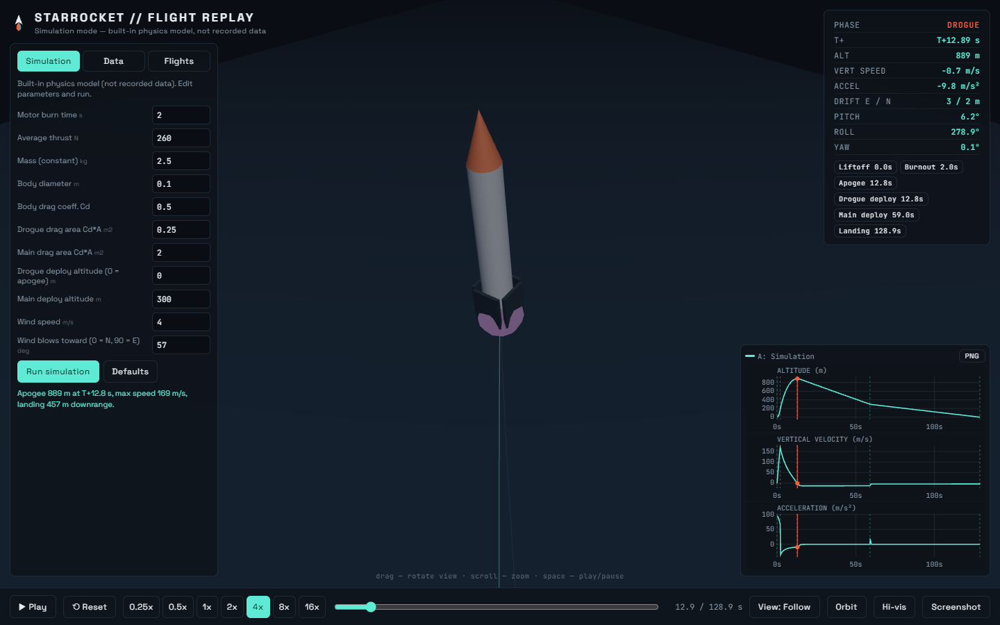
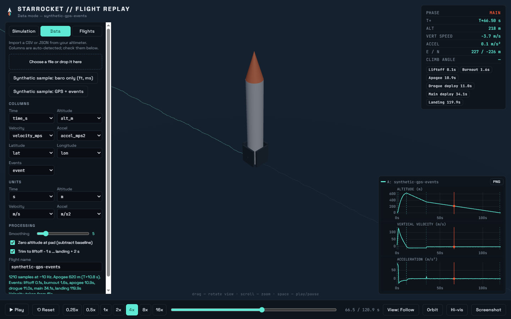
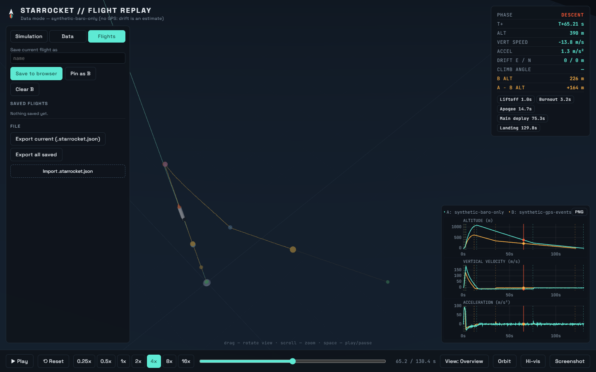

<p align="center"></p>

# StarRocket Flight Replay

A zero-build web app that replays a rocket flight in 3D with live telemetry and graphs. It runs a built-in
physics simulation, or you can import a CSV/JSON from your own altimeter and replay the real flight.
Flights can be saved, exported and compared side by side.

## About StarRocket

StarRocket is a student rocketry team from a university mechanics club (Meca Club). The team launched rockets
in Canada and the USA and won 2nd place in the Algerian rocketry competition twice (2024 and 2025). Nidhal was
a team member and built this replay tool to show the rocket's trajectory during the first competition.

The first version was a single HTML page driven by a scripted simulation. It is kept unchanged in
[`original/`](original/) and this repository grows it into a tool that can also read recorded data.



## Features

- **Simulation mode**: motor burn time, thrust, mass, body drag, drogue/main drag area, deploy altitudes and
  wind are editable; the physics runs in a separate, unit-tested module.
- **Data mode**: import altimeter CSV or JSON. Columns are auto-detected (time, altitude, optional velocity,
  acceleration, lat, lon, events). Pick units (m/ft, s/ms and more), smoothing and baseline options. Velocity is
  derived from altitude when missing. Liftoff, burnout, apogee, drogue/main deploy and landing are detected
  from the data (or taken from an event column). With lat/lon you get a 3D downrange path; without, a vertical
  path plus a wind-drift estimate that you control.
- **Save / load / compare**: save flights to a named list in the browser (localStorage), export and import
  `.starrocket.json` files, and overlay two flights: altitude/velocity/acceleration graphs and both
  trajectories in 3D, aligned at liftoff.
- **Telemetry HUD and graphs** synced to the timeline: altitude, vertical velocity, acceleration, phase,
  position. Click or drag on a graph to seek. Playback speed 0.25x to 16x, keyboard shortcuts
  (space, left/right arrows). PNG export of the graphs and a screenshot of the 3D view.
- **Camera**: follow, overview and a cinematic mode (slow orbit, zoom and shake during the burn), an optional
  auto-orbit, and a high-visibility look. These camera ideas come from the earlier demos in `original/`.

| Data mode (synthetic GPS sample) | Compare two flights |
|---|---|
|  |  |

All screenshots show the **synthetic** sample files or the built-in simulation, not real flight data.

## Quick start

Requires Node 22 or newer for the tests and the local server; the app itself needs only a browser.

```bash
npm test          # unit tests (node:test, no dependencies to install)
npm start         # serves the app at http://localhost:8080/
```

Any static server works (`python -m http.server`, GitHub Pages, ...). Opening `index.html` straight from disk
also works, except for the built-in *synthetic sample* buttons, which need `fetch`. Three.js (r128) is loaded
from cdnjs, so an internet connection is needed to view the page.

## Import your altimeter CSV

1. Export the flight log from your altimeter or flight computer as CSV (or JSON).
2. Open the **Data** tab, choose the file or drop it on the drop zone.
3. Check the detected **columns** and **units** (for example `ft` and `ms`). Change them if the guess is wrong.
4. Adjust smoothing; keep *Zero altitude at pad* on unless the file is already height above ground.
5. If the file has no lat/lon, enter the wind speed and direction for the drift estimate (or leave 0 for a
   purely vertical path).
6. Read the detected events in the Events chips (click one to jump there). Detection is heuristic, so check it.
7. Save the flight in the **Flights** tab, or export it as `.starrocket.json`.

Column names are matched by pattern (`time`, `time_ms`, `Altitude (ft)`, `baro_alt`, `lat`, `lon`, ...), so many
exports work unchanged. No specific altimeter product has been tested; if your file is not recognised, choose
the columns by hand.

Minimum file:

```csv
time_s,altitude_m
0.00,0.1
0.05,0.6
0.10,2.4
```

### Format spec

The full specification (delimiters, column aliases, units, processing, event rules, JSON and
`.starrocket.json` layouts) is in [docs/CSV_FORMAT.md](docs/CSV_FORMAT.md).

## Sample data

[`samples/`](samples/) contains two **synthetic** CSVs generated from the simulation plus seeded noise. They are
not real StarRocket flights and are labelled as such inside the files. Loading `synthetic-gps-events.csv` gives
this real output from the importer:

```
1210 samples at ~10 Hz. Apogee 620 m (T+10.8 s).
Events: liftoff 0.1s, burnout 1.6s, apogee 10.9s, drogue 11.0s, main 34.1s, landing 119.9s
```

## Tests

```
$ npm test
ℹ tests 55
ℹ pass 55
ℹ fail 0
```

They cover CSV parsing and column detection, unit conversion, smoothing and derived velocity, event
detection (recovering apogee, burnout, main deploy and landing from noisy altitude-only data), the GPS path
and drift estimate, the physics model (apogee vs drag/thrust/mass, deploy altitudes, wind, terminal velocity),
save/load validation and graph helpers.

`node tools/browser-check.mjs` is an optional smoke test that loads the page in a locally installed headless
Chrome or Edge, fails on any console error and rewrites the screenshots in `screenshots/`.

## Project structure

```
index.html            page shell
css/style.css
src/
  units.js            unit tables, header unit hints
  csv.js              CSV/JSON parsing, column detection
  events.js           event detection, phase naming
  flight.js           flight model: smoothing, derivatives, GPS projection, drift estimate, sampling
  physics.js          simulation mode physics (pure)
  storage.js          localStorage list, .starrocket.json import/export, validation
  graph.js            canvas graphs, overlay, PNG sheet
  scene.js            Three.js scene and camera modes
  main.js             UI wiring
tests/                node:test suites
samples/              synthetic example CSVs
docs/CSV_FORMAT.md    data format spec
tools/                local server, sample generator, browser smoke test
original/             the earlier single-file pages, unchanged
```

## How it works

Every flight, simulated or imported, becomes the same object: time-stamped frames (altitude, vertical velocity,
acceleration, east/north position, attitude) plus a list of events. The replay, HUD, graphs, saving and
comparison all work on that one shape.

**Simulation** integrates a 1-D vertical point mass with quadratic drag, a constant-thrust motor, an
exponential atmosphere and two parachutes that open over 0.5 s. Horizontal motion relaxes toward the wind speed.
Attitude angles are scripted for looks only.

**Data** is converted to SI, de-duplicated, zeroed, smoothed, and enriched (velocity, acceleration, events,
position). Comparison aligns the two flights at their liftoff event.

## Limitations

- The simulation is deliberately simple: constant mass, no gravity turn or weathercocking, vertical flight
  with a wind-relaxation drift model. It is for visualisation, not design decisions.
- Event detection is heuristic. A drogue that fires at apogee is not visible in altitude data and is only
  shown if the file labels it.
- Orientation in data mode is derived from the velocity vector (climb) and shown upright under canopy; real
  attitude (IMU) data is not imported yet.
- Without GPS, the downrange path is an estimate from the wind you enter.
- localStorage is small (about 5 MB) and per browser; export to a file to keep or share flights.
- The sample files and screenshots are synthetic.

## Roadmap

- Import IMU attitude (quaternion or pitch/roll/yaw columns) to drive the 3D orientation.
- Time-aligned compare against a modelled flight with a residual graph.
- Per-event offsets and manual event editing.
- Kalman-style fusion of barometer and accelerometer for velocity.
- Map/trajectory top-down view and KML/GPX export.

## The earlier pages (`original/`)

Kept unchanged for history. All are single HTML files written by Nidhal in June 2026.

| File | What it is |
|---|---|
| `starrocket-replay.html` | The shared copy of the "StarRocket Flight Replay" page this project started from (scripted simulation) |
| `2024 Starrocket vs raspberry pi simulation.html` | The original file name of that same page (identical content) |
| `StarRocket_Pro_Flight_Replay.html` | "Professional Flight Replay": turnaround camera and a more detailed rocket mesh |
| `StarRocket_Turnaround_Demo.html` | "Cinematic Demo": telemetry, altitude profile, demo camera with zoom and shake |
| `StarRocket_FailSafe.html`, `StarRocket_VISIBLE.html` | Small demos, including the high-visibility look |

Note: apart from the Pro page and the Fail-Safe demo (which has no Three.js script), these files load Three.js from
`.../three.js/128/three.min.js` on cdnjs. That URL returns 404 (the working path is `r128`), so they may not render
online as they are. This app uses the `r128` path.

## License

MIT. See [LICENSE](LICENSE).
